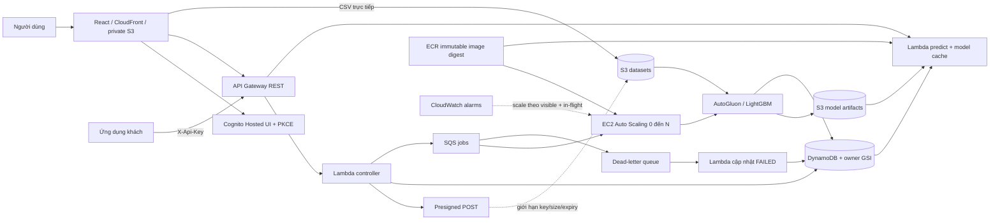

# Kiến trúc Stratus

## Các lớp

- `controller.py` / `predict.py`: Lambda proxy HTTP; validation body, auth, status mapping, CORS.
- `http.owner`: chỉ lấy owner từ authorizer claims; AWS fail closed nếu không có Cognito identity.
- `DatasetService`: ticket upload, profile CSV, immutable snapshots, deterministic preprocessing.
- `JobService`: owner checks, submit, listing, cancellation/retry, deployment, revoke/rotate.
- `TrainingService`: conditional claim, lease heartbeat, train, upload artifact, finish bằng owner token.
- `PredictionService`: credential check, deployment status/version check, strategy + model cache.
- `DynamoJobRepository`, `S3ArtifactStore`, `SQSJobQueue`: AWS adapters; `runtime.py` là composition root.
- `MLTask` Strategy, `TaskFactory` explicit registry, `TabularTask` Template Method.

Không import AutoGluon/pandas trong controller. Chỉ worker/predict load thư viện ML khi cần.
Frontend không gọi DynamoDB/SQS/ECR trực tiếp và không giữ AWS credentials. Upload S3 là URL ký tạm,
key giới hạn cố định dưới `uploads/<owner>/...`; không cho client upload pickle/model.

## Trạng thái bền vững

DynamoDB table có partition key `id`:

- Job: `<job_id>`, kind `job`.
- Dataset: `dataset#<dataset_id>`, kind `dataset`.
- Deployment: `deploy#<deployment_id>`, kind `deployment`.

GSI `by-owner`: partition `scope=<owner>#<kind>`, sort `created_id=<timestamp>#<id>`.
List dùng Query và cursor, không scan toàn bảng. GET theo ID dùng consistent read và owner check.
Bật SSE, PITR, retained table khi xóa stack.

S3 staging uploads hết hạn 1 ngày. `complete` tạo snapshot với key mới; tái sử dụng presigned URL
không thay đổi dữ liệu mà job đang đọc. Preprocess luôn sinh dataset ID mới. Profile chỉ chứa preview
bounded, không nhét CSV vào DynamoDB.

## Train và delivery semantics

1. Submit xác minh dataset/task/target, lưu QUEUED rồi gửi job ID vào SQS.
2. Worker bật instance scale-in protection; conditional update claim QUEUED hoặc lease TRAINING hết hạn.
3. Mỗi 30s gia hạn lease và message visibility. Mỗi worker train một job; nhiều worker có thể train song song.
4. Strategy train AutoGluon/LightGBM, lấy validation leaderboard, save-space, đóng ZIP và upload S3.
5. Artifact key `models/<job_id>/<attempt_owner>.zip` tách attempts; finish chỉ khi lease owner còn khớp.
6. COMPLETED/FAILED/CANCELLED được ack; delivery trùng gặp active lease không được ack.
7. Sau nhiều worker crash/redelivery, SQS chuyển sang DLQ. Lambda DLQ cập nhật FAILED khi không có active lease.

SQS là at-least-once. Đây không phải exactly-once transaction giữa S3, DynamoDB và SQS: lỗi enqueue đánh dấu
FAILED, một số artifact orphan có thể còn khi process chết giữa các bước. Không xóa artifact tự động nếu
chưa xác minh còn deployment/job sử dụng.

AutoGluon time limit là soft budget. Lỗi train được ghi FAILED; crash/OOM được redelivery sau visibility.
Lease và instance protection không thay thế monitoring hay bảo vệ mọi lỗi EC2.

## Scaling

`QueueHasWork` nhìn visible messages >0: thêm một worker với cooldown 300s, giới hạn MaxWorkers.
Cách này khởi động được từ 0 mà không chia metric cho số instance=0.
`QueueIdle` dùng `visible + not-visible == 0` trong 15 phút rồi ExactCapacity=0.
Worker không mở inbound; outbound qua public IPv4/IGW. AL2023 + Docker + IMDSv2.

## Deployment và inference image

Một image ECR theo digest dùng chung cho controller/worker/predict/DLQ; command của mỗi service khác nhau.
Dockerfile dựa trên Lambda Python 3.12, import-check AutoGluon khi build. EC2 override entrypoint để chạy
`python -m app.worker`; Lambda giữ Runtime Interface Client từ base image.

Model artifact ở S3, deployment chỉ ánh xạ model + task + runtime digest + hash key trong DynamoDB.
Không build image per-model. Lambda tải ZIP từ prefix tin cậy, kiểm tra path traversal/symlink/giới hạn
uncompressed, load AutoGluon cùng phiên bản rồi cache một model trên warm instance trong `/tmp`.
Không nhận model artifact từ người dùng vì AutoGluon loader sử dụng pickle.

Model và runtime digest khác nhau bị từ chối. Đổi runtime cần train/deploy lại; phục vụ nhiều runtime
đồng thời cần nhiều stack/version (ngoài luồng đơn giản hiện tại).

## ML preprocessing

Tiền xử lý chỉ thực hiện các quy tắc không fit tham số thống kê: trim chuỗi, normalize missing,
bỏ cột, bỏ missing target, deduplicate. AutoGluon tách validation và học feature transformation ở bước train.
Classification ép binary/multiclass theo số nhãn; regression yêu cầu target số hữu hạn; tabular để AutoGluon suy luận.
Chỉ dùng LightGBM để giữ container nhỏ và inference CPU. Validation score chưa chứng minh generalization;
cần thêm test set độc lập cho bài toán thực tế.

## Security và giới hạn

Cognito + API authorizer bảo vệ quản trị; deployment token ngẫu nhiên 256 bit bảo vệ prediction.
Stored SHA-256, constant-time compare, rotation/revocation. Cognito pool admin-only, API Gateway throttle
best effort. CORS chỉ cấu hình origin frontend nhưng CORS không thay thế authentication.

S3 private, CloudFront OAC, HTTPS policies, SQS/EBS encryption, IMDSv2, roles riêng. Chi phí còn tồn tại
khi ASG=0. Không claim hệ thống đã load-test hay production-hardened; cần đo memory/latency/cost/quota trên
AWS account thật trước rollout cho lượng truy cập lớn.

## Thêm strategy

Implement `MLTask.validate_training`, `train` (ghi model và trả metrics dict), `load`, `predict`;
đăng ký allowlist trong `default_factory`. Không import module từ user input. Bài toán GPU/time-series/NLP
cần dependency, schema và resource pool riêng, không chỉ thêm một tên task.

Nguồn: [AWS SQS scaling](https://docs.aws.amazon.com/autoscaling/ec2/userguide/as-using-sqs-queue.html),
[Lambda image requirements](https://docs.aws.amazon.com/lambda/latest/dg/images-create.html),
[AutoGluon deployment](https://auto.gluon.ai/stable/tutorials/tabular/advanced/tabular-deployment.html).
